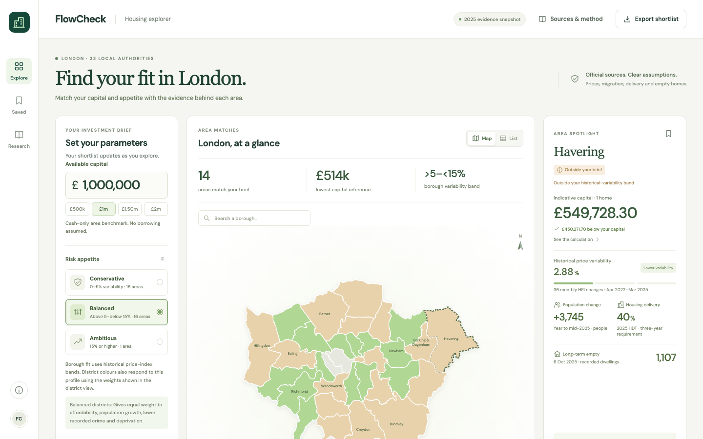
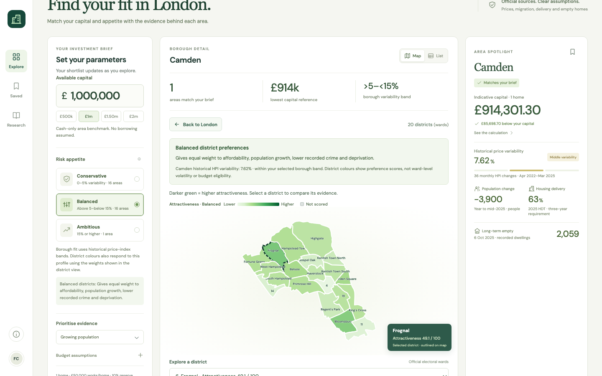
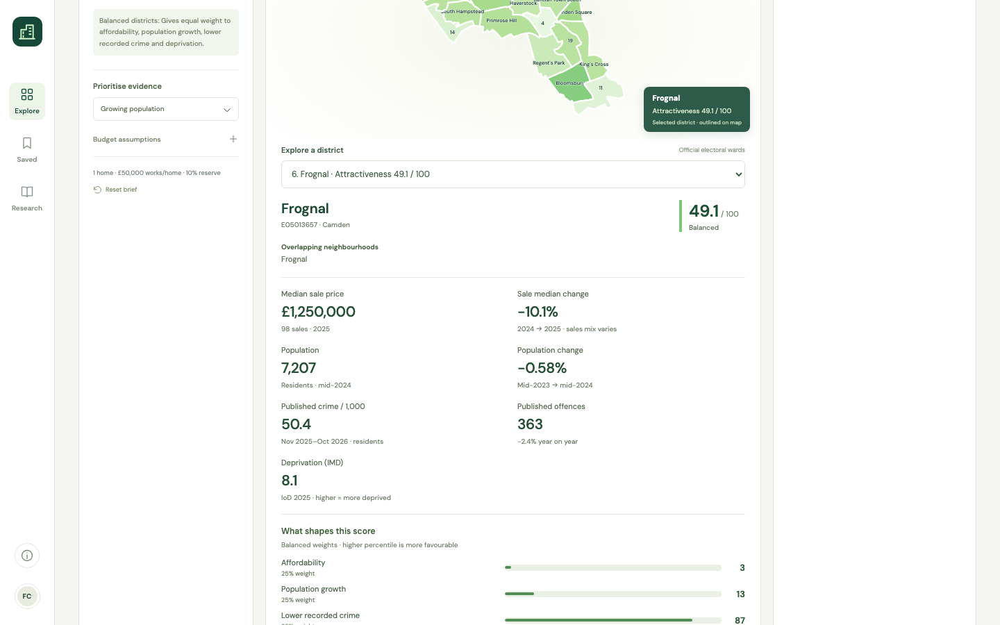

<div align="center">

# 🏠 FlowCheck

### London housing evidence, borough by borough and ward by ward

**Enter a budget and a risk appetite. See which London boroughs fit, why, and what the official evidence says, down to all 704 electoral wards.**

Built at a hackathon for **House London** · React 19 · TypeScript · Python FastAPI · official open data

[**▶ Try the demo**](#-try-it-in-30-seconds) · [How it works](#-how-it-works) · [Data](#-the-data) · [Run locally](#-run-it-locally) · [Limitations](#%EF%B8%8F-honest-limitations)

</div>



---

## 💡 The problem

London's housing debate mixes up three things that are measured separately: **people moving**, **homes being built** and **money being spent**. Official figures for each exist, but they're scattered across ONS, MHCLG, HM Land Registry, the GLA and the Met Police, with different dates, units and geographies.

**FlowCheck puts that evidence side by side on one map, keeps every source and date visible, and says clearly what the numbers can and can't tell you.**

## ✨ What it does

| | Feature |
|---|---|
| 💷 | **Budget matching.** Enter capital, number of homes, a works allowance and a reserve. FlowCheck shows the indicative cash needed in each of the 33 London areas, to the penny. |
| 📊 | **Risk appetite.** Conservative, Balanced or Ambitious bands based on how much each borough's official house-price index has moved historically. These are screening bands, not predictions. |
| 🗺️ | **Interactive borough map.** Matching boroughs are highlighted. Every excluded borough says exactly why: over budget, outside the band, or both. |
| 🔍 | **Ward drill-down.** Click any borough to open its electoral wards (704 across London). Each ward shows median sale price, population change, published crime and deprivation. |
| 🟢 | **Explained ward scores.** Wards are shaded on a 0–100 scale built from four indicators, with weights shown for every risk profile. No black box. |
| 📝 | **Evidence briefs.** One click gives a source-linked summary of a borough and three concrete things to investigate next. |
| ⭐ | **Shortlist and export.** Save areas in your browser and export a CSV. No account, and nothing about you is stored on a server. |
| 📚 | **Sources everywhere.** Publisher, period and licence sit beside every figure, with the method and limitations one click away. |

<table>
<tr>
<td width="50%"></td>
<td width="50%"></td>
</tr>
<tr>
<td align="center"><sub><b>Ward drill-down:</b> Camden's 20 wards, shaded by score</sub></td>
<td align="center"><sub><b>Ward evidence:</b> raw figures, periods and score breakdown</sub></td>
</tr>
</table>

---

## 🚀 Try it in 30 seconds

**No installation needed.** Download [`FlowCheck_Open_Me.html`](FlowCheck_Open_Me.html) and double-click it. It opens in Chrome or Edge with all the data and maps built in, and works offline.

> On GitHub, open the file, click **Download raw file**, then open it from your Downloads folder.

**Quick tour:**
1. The page opens with **£1,000,000** and **Balanced**: 14 of 33 London areas match.
2. Click a green borough, e.g. **Camden**, to open its wards.
3. Click a ward to see its prices, population, crime and deprivation.
4. Press **Create evidence brief** for a source-linked summary.
5. Change the budget or risk appetite and watch the map update.

---

## 🧮 How it works

### Borough matching
A borough **matches** only when both checks pass:

```
1. Budget:  homes × (Mar 2025 borough average price + works allowance) × (1 + reserve %)  ≤  your capital
2. Appetite: borough's historical price variability falls inside your band
```

| Appetite | Historical variability band |
|---|---|
| 🛡️ Conservative | 0–5% |
| ⚖️ Balanced | above 5% and below 15% |
| 📈 Ambitious | 15% or higher |

*Variability* is the annualised standard deviation of 36 monthly changes in the official UK House Price Index (Apr 2022 – Mar 2025). The priority you pick (population growth, housing delivery shortfall or empty homes) changes the **order** of results, never which boroughs match.

The same matching logic is implemented in **TypeScript** (browser) and **Python** (API), and an automated parity test keeps the two in step.

### Ward scores
Each ward gets a 0–100 score from four London-wide percentiles: **lower median sale price**, **higher population growth**, **lower published crime per resident** and **lower deprivation**. The risk profile sets the weights:

| Profile | Affordability | Population growth | Lower crime | Lower deprivation |
|---|---:|---:|---:|---:|
| Conservative | 25% | 5% | 35% | 35% |
| Balanced | 25% | 25% | 25% | 25% |
| Ambitious | 35% | 45% | 10% | 10% |

These weights are explicit product choices, not an official rating. Wards with missing indicators or fewer than 20 sales are shown grey and **unscored**. Missing values are never filled with zeros or averages.

---

## 📦 The data

All official, openly licensed and dated. FlowCheck uses a **fixed snapshot**, not live prices.

| Evidence | Source | Period |
|---|---|---|
| House prices and price index | HM Land Registry / ONS UK HPI | March 2025 (index Mar 2022–Mar 2025) |
| Migration and population | ONS mid-year estimates | Year to mid-2025 |
| Housing Delivery Test | MHCLG | 2022/23 – 2024/25 |
| Net new homes | MHCLG | 2024/25 |
| Long-term empty homes | MHCLG (Council Tax records) | 6 October 2025 |
| Ward sale prices | HM Land Registry Price Paid | Calendar 2025 (vs 2024) |
| Ward population | ONS small-area estimates | Mid-2024 (vs mid-2023) |
| Ward deprivation | English Indices of Deprivation | 2025 |
| Ward crime | Metropolitan Police recorded crime | Nov 2025 – Oct 2026 |
| Boundaries and names | GLA, ONS, Ordnance Survey, House of Commons Library | 2024–2025 |

The ward dataset (684 wards and 1,002 neighbourhoods) is in [`datasets/london-wards/`](datasets/london-wards/), with its own [README](datasets/london-wards/README.md), [source audit](datasets/london-wards/SOURCE_AUDIT.md) and [validation report](datasets/london-wards/validation_report.json).

---

## 💻 Run it locally

**Frontend (Node 22.18+)**
```bash
npm ci
npm run dev          # open the URL Vite prints
npm run build        # production build into dist/
```

**Streamlit wrapper** (serves the standalone demo)
```bash
pip install -r requirements.txt
streamlit run streamlit_app.py
```

**Python API (3.12+)**
```bash
python3 -m venv .venv
.venv/bin/pip install -r backend/requirements.txt
cd backend && ../.venv/bin/uvicorn app.main:app --reload --port 8000
# interactive docs at http://localhost:8000/docs
```

**Full stack: React + FastAPI + PostgreSQL via Docker**
```bash
cp .env.example .env   # set your own POSTGRES_PASSWORD
docker compose up --build   # http://localhost:8080
```

Optional: set `OPENAI_API_KEY` on the server for an AI-assisted paragraph in evidence briefs. Everything else, including all numbers, matching and sources, works without it.

### API

| Route | Purpose |
|---|---|
| `GET /api/health` | Data-store health and coverage |
| `GET /api/areas` | All area data, policy and sources |
| `POST /api/match` | Profile → matching and excluded boroughs with reasons |
| `POST /api/brief` | Area + profile → source-based evidence brief |

---

## ✅ Testing

```bash
npm test                                            # 25 frontend and model tests
cd backend && python3 -m unittest discover -s tests # 12 API tests
python3 scripts/validate-ward-data.py               # 22 ward-data consistency checks
```

The tests cover matching at the penny boundary, budget and appetite behaviour, TypeScript/Python parity, data joins, missing-data handling, input validation, rate limiting and the no-AI fallback.

---

## 🗂️ Project structure

```
├── FlowCheck_Open_Me.html     # standalone offline demo (double-click)
├── FlowCheck_Pitch_Deck.pptx  # hackathon pitch deck
├── streamlit_app.py           # Streamlit wrapper for the demo
├── src/                       # React + TypeScript frontend
│   ├── App.tsx                #   main interface
│   ├── WardMap.tsx            #   ward drill-down map
│   ├── matching.ts            #   budget and appetite matching
│   └── wardAttractiveness.ts  #   ward score model
├── backend/app/               # FastAPI service (mirrors the matching logic)
├── public/data/               # borough evidence, policy, maps, ward indicators
├── datasets/london-wards/     # ward and neighbourhood dataset, audit, validation
├── scripts/                   # data import, validation and offline export
├── tests/                     # frontend and model tests
└── docs/                      # screenshots and full technical notes
```

---

## ⚠️ Honest limitations

FlowCheck is a **screening tool, not investment advice**. It does not predict prices, returns or losses.

- **Different units and dates.** People, households and dwellings are different things, measured over different periods. Nothing here claims one *causes* another.
- **Averages hide detail.** Borough and ward medians conceal differences between streets and property types. Medians describe what sold, not what a typical home is worth.
- **Wards are approximate.** Ward figures are built from whole small statistical areas (ONS best-fit), so edges are fuzzy.
- **Crime rates in the centre.** Rates per resident look high in central wards because many visitors and workers pass through. They are not a measure of personal risk. The City of London has its own police force, so Met figures don't cover it.
- **Small samples.** Wards with fewer than 20 sales are flagged and left unscored.
- **Empty homes.** A recorded empty home isn't necessarily available or recoverable.
- **Not live.** This is a dated snapshot, and not every figure has been independently re-derived (see the [source audit](datasets/london-wards/SOURCE_AUDIT.md)).

📖 Full method, provenance and research notes: [`docs/TECHNICAL.md`](docs/TECHNICAL.md)

---

## 👥 Team

Built by **Bartlomiej Kuzma** ([@8ARTEZZIO](https://github.com/8ARTEZZIO)), **[@TTRum-code](https://github.com/TTRum-code)** and **Hein Htet Phyo** ([@HeinHtet-Phyo](https://github.com/HeinHtet-Phyo)) for the House London hackathon, November 2026.

Original team repository: [8ARTEZZIO/FlowCheck](https://github.com/8ARTEZZIO/FlowCheck)

## 📄 Licence and attribution

Contains HM Land Registry, ONS, MHCLG, GLA and Ordnance Survey public sector information licensed under the [Open Government Licence v3.0](https://www.nationalarchives.gov.uk/doc/open-government-licence/version/3/). Metropolitan Police data is used under OGL v2.0, and House of Commons Library neighbourhood names under the Open Parliament Licence. Data retrieved 7 November 2026.
